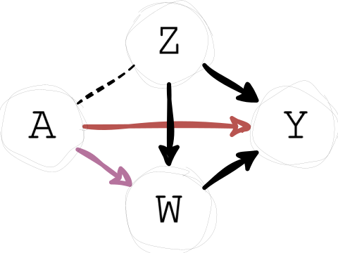

# Target and Research Questions {#target}

LLM-driven jurisdictional decisions that come with an explanation of *whether* they are biased and *how* the bias can be mitigated.

::: {.pipeline .fragment}
::: {.stage}
[<i class="fa-solid fa-file-lines"></i>Court file]{.box}
[<i class="fa-solid fa-scale-balanced"></i> RQ1 define]{.rq}
:::
::: {.stage}
[<i class="fa-solid fa-robot"></i>LLM]{.box}
[<i class="fa-solid fa-shield-halved"></i> RQ3 mitigate]{.rq}
:::
::: {.stage}
[<i class="fa-solid fa-gavel"></i>Decision]{.box}
[<i class="fa-solid fa-magnifying-glass"></i> RQ2 identify]{.rq}
:::
::: {.stage}
[<i class="fa-solid fa-comment-dots"></i>Explanation]{.box}
[<i class="fa-solid fa-comment-dots"></i> RQ4 explain]{.rq}
:::
:::

::: {.rq-list .fragment .incremental}
- [<i class="fa-solid fa-scale-balanced"></i> RQ1]{.rq} How to **define** bias in jurisdictional decisions? → [Step 1](#step-1)
- [<i class="fa-solid fa-magnifying-glass"></i> RQ2]{.rq} How to **identify** bias in LLM-driven jurisdictional decisions? → [Step 2](#step-2)
- [<i class="fa-solid fa-shield-halved"></i> RQ3]{.rq} How to **mitigate** bias in LLM-driven jurisdictional decisions? → [Step 3](#step-3)
- [<i class="fa-solid fa-comment-dots"></i> RQ4]{.rq} How to **explain** bias in LLM-driven jurisdictional decisions? → [Step 4](#step-4)
:::

# Causal Bias-Pathways in Jurisdictional Decision-making [<i class="fa-solid fa-scale-balanced"></i> RQ1a]{.rq} {#pathways}
Through which causal pathways (mediators, confounders) do sensitive attributes affect decisions?

:::: {.columns .fragment}
::: {.column width="45%"}
{.dag width="80%"}
:::
::: {.column width="55%" .callout-tip icon="false" appearance="simple"}
## Example (illustrative): drunk driving

- **A** sensitive attribute: nationality
- **Z** confounder: age
- **W** mediator: prior traffic offenses
- **Y** decision: fine and length of driving ban

[Direct]{.path-direct-bias} A → Y<br/>[Indirect]{.path-indirect-bias} A → W → Y<br/>Spurious A ┄ Z → Y
:::
::::


# Step 2: Testing [<i class="fa-solid fa-magnifying-glass"></i> RQ2]{.rq} {#step-2}

::: {.callout-note .fragment appearance="simple"}
## Method
1. **Generate** coupled **factual** and **counterfactual** test **datasets** for each identified causal bias pathway
2. Generate **LLM-decisions** for each factual and counterfactual test dataset
3. **Compare** the LLM-decisions to quantify the effect of sensitive attributes through each causal bias pathway
:::

::: {.fragment}
```{=html}
<div class="testflow">
  <div class="hd">Causal DAG</div><div></div><div class="hd">Test cases</div><div></div><div class="hd">LLM</div><div></div><div class="hd">Decision</div><div></div><div class="hd">Effect</div>
  <div class="dagcell"><span class="lab">Factual</span></div>
  <div class="arr"><i class="fa-solid fa-arrow-right"></i></div>
  <div class="box"><i class="fa-solid fa-file-lines"></i>Court files</div>
  <div class="arr"><i class="fa-solid fa-arrow-right"></i></div>
  <div class="box llm"><i class="fa-solid fa-robot"></i>LLM</div>
  <div class="arr"><i class="fa-solid fa-arrow-right"></i></div>
  <div class="box"><i class="fa-solid fa-gavel"></i><span>Y</span></div>
  <div class="arr"><i class="fa-solid fa-arrow-right"></i></div>
  <div class="box effect"><span class="ttl"><i class="fa-solid fa-magnifying-glass"></i> Compare</span>
    <table class="efftab">
      <thead><tr><th>Path</th><th>Contrast</th><th>Δ mo*</th><th>p*</th></tr></thead>
      <tbody>
        <tr><td class="path-direct-bias">direct</td><td>Y − Y′<sub>1</sub></td><td>+1.2</td><td>&lt;.001</td></tr>
        <tr><td class="path-indirect-bias">indirect</td><td>Y′<sub>1</sub> − Y′<sub>2</sub></td><td>+0.5</td><td>.041</td></tr>
        <tr class="total"><td>total</td><td>Y − Y′<sub>2</sub></td><td>+1.7</td><td>&lt;.001</td></tr>
      </tbody>
    </table>
    <small class="note">* illustrative</small>
  </div>
  <div class="dagcell"><span class="lab">Counterfactual 1<br/><small>no direct path</small></span></div>
  <div class="arr"><i class="fa-solid fa-arrow-right"></i></div>
  <div class="box"><i class="fa-solid fa-file-lines"></i><span>Court files′<sub>1</sub></span></div>
  <div class="arr"><i class="fa-solid fa-arrow-right"></i></div>
  <div class="arr"><i class="fa-solid fa-arrow-right"></i></div>
  <div class="box"><i class="fa-solid fa-gavel"></i><span>Y′<sub>1</sub></span></div>
  <div class="arr"><i class="fa-solid fa-arrow-right"></i></div>
  <div class="dagcell"><span class="lab">Counterfactual 2<br/><small>no bias paths</small></span></div>
  <div class="arr"><i class="fa-solid fa-arrow-right"></i></div>
  <div class="box"><i class="fa-solid fa-file-lines"></i><span>Court files′<sub>2</sub></span></div>
  <div class="arr"><i class="fa-solid fa-arrow-right"></i></div>
  <div class="arr"><i class="fa-solid fa-arrow-right"></i></div>
  <div class="box"><i class="fa-solid fa-gavel"></i><span>Y′<sub>2</sub></span></div>
  <div class="arr"><i class="fa-solid fa-arrow-right"></i></div>
</div>
```
:::

::: {.callout-tip .fragment appearance="simple"}
## Contribution
- **Generation pipeline** for coupled factual-counterfactual test datasets
- **Quantification** of causal bias effects in LLM-driven decisions
:::


# Step 3: Mitigation [<i class="fa-solid fa-shield-halved"></i> RQ3]{.rq} {#step-3}

::: {.callout-note .fragment appearance="simple"}
## Method A
- Use Modular Latent-Space Operations (MLOs) to intervene on sensitive attributes and their causal pathways in the latent space of an LLM.
- Generate decisions for all factual and counterfactual versions of the DAG.
:::

::: {.callout-note .fragment appearance="simple"}
## Method B
- Pre-process input data with a text autoencoder and MLOs.
- Generate decisions for all factual and counterfactual versions of the DAG.
:::


::: {.callout-tip .fragment appearance="simple"}
## Contribution
- Application of MLOs [@kestel2026mlo]
- Method to provide selection of factual and counterfactual LLM-decisions:
  - Automated factual AND counterfactual decision
:::


# Step 3: Mitigation [<i class="fa-solid fa-shield-halved"></i> RQ3]{.rq}
TODO: Example Mermaid DAG


# Step 4: Explanation [<i class="fa-solid fa-comment-dots"></i> RQ1]{.rq} {#step-4}

::: {.callout-note .fragment appearance="simple"}
## Method
Use an LLM to explain the effect quantification output from Step 3 in natural language.
:::

::: {.callout-tip .fragment appearance="simple"}
## Contribution
- Application of LLM-explanation methodology [@berarducci2026cfa_llm]
- Understandable explanation of causal bias effects in one particular LLM-driven decision
:::

TODO: Example Mermaid DAG

# Step 1: Conceptualization [<i class="fa-solid fa-scale-balanced"></i> RQ1b]{.rq} {#step-1}

::: {.callout-note .fragment appearance="simple"}
## Method
- Workshops with legal experts to identify causal pathways and construct causal DAGs
- Collaboration with ADA project^[[ada-oeffentliche-verwaltung.de](https://ada-oeffentliche-verwaltung.de)]
- 1 Workshop for each use case
:::

::: {.fragment}
```{mermaid}
---
config:
  block:
    padding: 15
---
block-beta
  columns 10
  space:2
  ws("fa:fa-users<br/>Expert workshop:<br/>Use Case 1"):2
  arr<["&nbsp;"]>(right)
  block:DAG:3
    columns 3
    space nZ(("Z")) space
    nA(("A")) space nY(("Y"))
    space nW(("W")) space
  end
  nA --> nW
  nW --> nY
  nA --> nY
  nZ --> nW
  nZ --> nY
  nA --- nZ
  space:2
```
:::

::: {.callout-tip .fragment appearance="simple"}
## Contribution
- Workshop/Interview guideline for causal DAG elicitation
- Causal DAG for each use case [@plecko2022sfm]
:::

# Final Bias Quantification and Mitigation Module

```{mermaid}
flowchart
  ws["Workshop"] --> dag("Causal DAG")
  dag --> bench("Test Dataset")
  bench --> effect("Causal Effect Quantification")
  dag --> scm["Structural Causal Model"]
  effect --> scm
  scm --> mlo["MLO Intervention"]
  text("Court file") --> mlo
  mlo --> cftext("Counterfactual court file")
  text --> y("LLM decision")
  cftext --> cfy("Counterfactual LLM decision")
  y --> effect
end
```

# References
