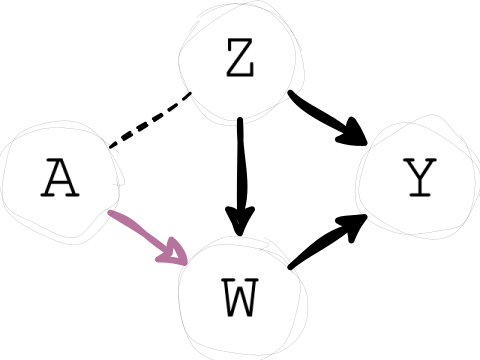

# Target and Research Questions {#target}

LLM-driven jurisdictional decisions that come with an explanation of *whether* they are biased and *how* the bias can be mitigated.

::: {.pipeline .fragment}
::: {.stage}
[<i class="fa-solid fa-file-lines"></i>Court file]{.box}
[<i class="fa-solid fa-scale-balanced"></i> RQ1 define]{.rq}
:::
::: {.stage}
[<i class="fa-solid fa-robot"></i>LLM]{.box}
[<i class="fa-solid fa-shield-halved"></i> RQ3 mitigate]{.rq}
:::
::: {.stage}
[<i class="fa-solid fa-gavel"></i>Decision]{.box}
[<i class="fa-solid fa-magnifying-glass"></i> RQ2 identify]{.rq}
:::
::: {.stage}
[<i class="fa-solid fa-comment-dots"></i>Explanation]{.box}
[<i class="fa-solid fa-comment-dots"></i> RQ4 explain]{.rq}
:::
:::

::: {.rq-list .fragment .incremental}
- [<i class="fa-solid fa-scale-balanced"></i> RQ1]{.rq} How to **define** bias in jurisdictional decisions? → [Step 1](#step-1)
- [<i class="fa-solid fa-magnifying-glass"></i> RQ2]{.rq} How to **identify** bias in LLM-driven jurisdictional decisions? → [Step 2](#step-2)
- [<i class="fa-solid fa-shield-halved"></i> RQ3]{.rq} How to **mitigate** bias in LLM-driven jurisdictional decisions? → [Step 3](#step-3)
- [<i class="fa-solid fa-comment-dots"></i> RQ4]{.rq} How to **explain** bias in LLM-driven jurisdictional decisions? → [Step 4](#step-4)
:::

# Causal Bias-Pathways in Jurisdictional Decision-making [<i class="fa-solid fa-scale-balanced"></i> RQ1a]{.rq} {#pathways}
Through which causal pathways (mediators, confounders) do sensitive attributes affect decisions?

:::: {.columns .fragment}
::: {.column width="45%"}
{.dag width="80%"}
:::
::: {.column width="55%" .callout-tip icon="false" appearance="simple"}
## Example (illustrative): drunk driving

- **A** sensitive attribute: nationality
- **Z** confounder: age
- **W** mediator: prior traffic offenses
- **Y** decision: fine and length of driving ban

[Direct]{.path-direct-bias} A → Y<br/>[Indirect]{.path-indirect-bias} A → W → Y<br/>Spurious A ┄ Z → Y
:::
::::


# Step 2: Testing [<i class="fa-solid fa-magnifying-glass"></i> RQ2]{.rq} {#step-2}

::: {.callout-note .fragment appearance="simple"}
## Method
1. **Generate** coupled **factual** and **counterfactual** test **datasets** for each identified causal bias pathway
2. Generate **LLM-decisions** for each factual and counterfactual test dataset
3. **Compare** the LLM-decisions to quantify the effect of sensitive attributes through each causal bias pathway
:::

::: {.fragment}
```{=html}
<div class="testflow">
  <div class="hd">Causal DAG</div><div></div><div class="hd">Test cases</div><div></div><div class="hd">LLM</div><div></div><div class="hd">Decision</div><div></div><div class="hd">Effect</div>
  <div class="dagcell"><span class="lab">Factual</span></div>
  <div class="arr"><i class="fa-solid fa-arrow-right"></i></div>
  <div class="box contrib"><i class="fa-solid fa-file-lines"></i>Court file</div>
  <div class="arr"><i class="fa-solid fa-arrow-right"></i></div>
  <div class="box llm"><i class="fa-solid fa-robot"></i>LLM</div>
  <div class="arr"><i class="fa-solid fa-arrow-right"></i></div>
  <div class="box"><i class="fa-solid fa-gavel"></i><span>Y</span></div>
  <div class="arr"><i class="fa-solid fa-arrow-right"></i></div>
  <div class="box effect contrib"><span class="ttl"><i class="fa-solid fa-magnifying-glass"></i> Compare</span>
    <table class="efftab">
      <thead><tr><th>Path</th><th>Contrast</th><th>Δ mo*</th><th>p*</th></tr></thead>
      <tbody>
        <tr><td class="path-direct-bias">direct</td><td>Y − Y′<sub>1</sub></td><td>+1.2</td><td>&lt;.001</td></tr>
        <tr><td class="path-indirect-bias">indirect</td><td>Y′<sub>1</sub> − Y′<sub>2</sub></td><td>+0.5</td><td>.041</td></tr>
        <tr class="total"><td>total</td><td>Y − Y′<sub>2</sub></td><td>+1.7</td><td>&lt;.001</td></tr>
      </tbody>
    </table>
    <small class="note">* illustrative</small>
  </div>
  <div class="dagcell"><span class="lab">Counterfactual 1<br/><small>no direct path</small></span></div>
  <div class="arr"><i class="fa-solid fa-arrow-right"></i></div>
  <div class="box contrib"><i class="fa-solid fa-file-lines"></i><span>Court file′<sub>1</sub></span></div>
  <div class="arr"><i class="fa-solid fa-arrow-right"></i></div>
  <div class="arr"><i class="fa-solid fa-arrow-right"></i></div>
  <div class="box"><i class="fa-solid fa-gavel"></i><span>Y′<sub>1</sub></span></div>
  <div class="arr"><i class="fa-solid fa-arrow-right"></i></div>
  <div class="dagcell"><span class="lab">Counterfactual 2<br/><small>no bias paths</small></span></div>
  <div class="arr"><i class="fa-solid fa-arrow-right"></i></div>
  <div class="box contrib"><i class="fa-solid fa-file-lines"></i><span>Court file′<sub>2</sub></span></div>
  <div class="arr"><i class="fa-solid fa-arrow-right"></i></div>
  <div class="arr"><i class="fa-solid fa-arrow-right"></i></div>
  <div class="box"><i class="fa-solid fa-gavel"></i><span>Y′<sub>2</sub></span></div>
  <div class="arr"><i class="fa-solid fa-arrow-right"></i></div>
</div>
```
:::

::: {.callout-tip .fragment appearance="simple"}
## Contribution
- **Generation pipeline** for coupled factual-counterfactual test datasets
- **Quantification** of causal bias effects in LLM-driven decisions
:::


# Step 3: Mitigation [<i class="fa-solid fa-shield-halved"></i> RQ3]{.rq} {#step-3}

<!-- ::: {.callout-note .fragment appearance="simple"}
## Method A
- Use Modular Latent-Space Operations (MLOs) to intervene on sensitive attributes and their causal pathways in the latent space of an LLM.
- Generate decisions for all factual and counterfactual versions of the DAG.
::: -->

::: {.callout-note .fragment appearance="simple"}
## Method
1. **Pre-process** input data with a text autoencoder and **MLOs**.
2. Generate decisions for all factual and counterfactual versions of the DAG.
:::

::: {.fragment}
```{=html}
<div class="testflow mitflow">
  <div class="hd">Real input</div><div></div><div class="hd">Encode</div><div></div><div class="hd">MLO intervention</div><div></div><div class="hd">Decode</div><div></div><div class="hd">Operated files</div><div></div><div class="hd">LLM</div><div></div><div class="hd">Decision options</div>
  <div class="box tall" style="grid-row:2 / span 3; grid-column:1"><i class="fa-solid fa-file-lines"></i><span>Court<br/>file</span></div>
  <div class="link" style="grid-row:2; grid-column:2 / 11"><i class="fa-solid fa-arrow-right"></i></div>
  <div class="dagcell marker" style="grid-row:2; grid-column:5"></div>
  <div class="arr tall" style="grid-row:3 / span 2; grid-column:2"><i class="fa-solid fa-arrow-right"></i></div>
  <div class="box tall" style="grid-row:3 / span 2; grid-column:3"><i class="fa-solid fa-compress"></i><span>Encoder</span></div>
  <div class="box tall" style="grid-row:3 / span 2; grid-column:7"><i class="fa-solid fa-expand"></i><span>Decoder</span></div>
  <div class="box tall" style="grid-row:2 / span 3; grid-column:11"><i class="fa-solid fa-robot"></i><span>LLM</span></div>
  <div class="arr" style="grid-row:2; grid-column:12"><i class="fa-solid fa-arrow-right"></i></div>
  <div class="box dec" style="grid-row:2; grid-column:13"><i class="fa-solid fa-gavel"></i><span>Y</span><span class="lab">factual</span></div>
  <div class="arr" style="grid-row:3; grid-column:4"><i class="fa-solid fa-arrow-right"></i></div>
  <div class="dagcell" style="grid-row:3; grid-column:5"><div class="box contrib"><i class="fa-solid fa-shield-halved"></i><span>MLO</span></div></div>
  <div class="arr" style="grid-row:3; grid-column:6"><i class="fa-solid fa-arrow-right"></i></div>
  <div class="arr" style="grid-row:3; grid-column:8"><i class="fa-solid fa-arrow-right"></i></div>
  <div class="box" style="grid-row:3; grid-column:9"><i class="fa-solid fa-file-lines"></i><span>Court file′<sub>1</sub></span></div>
  <div class="arr" style="grid-row:3; grid-column:10"><i class="fa-solid fa-arrow-right"></i></div>
  <div class="arr" style="grid-row:3; grid-column:12"><i class="fa-solid fa-arrow-right"></i></div>
  <div class="box dec" style="grid-row:3; grid-column:13"><i class="fa-solid fa-gavel"></i><span>Y′<sub>1</sub></span><span class="lab">no direct<br/>bias</span></div>
  <div class="arr" style="grid-row:4; grid-column:4"><i class="fa-solid fa-arrow-right"></i></div>
  <div class="dagcell" style="grid-row:4; grid-column:5"><div class="box contrib"><i class="fa-solid fa-shield-halved"></i><span>MLO</span></div></div>
  <div class="arr" style="grid-row:4; grid-column:6"><i class="fa-solid fa-arrow-right"></i></div>
  <div class="arr" style="grid-row:4; grid-column:8"><i class="fa-solid fa-arrow-right"></i></div>
  <div class="box" style="grid-row:4; grid-column:9"><i class="fa-solid fa-file-lines"></i><span>Court file′<sub>2</sub></span></div>
  <div class="arr" style="grid-row:4; grid-column:10"><i class="fa-solid fa-arrow-right"></i></div>
  <div class="arr" style="grid-row:4; grid-column:12"><i class="fa-solid fa-arrow-right"></i></div>
  <div class="box dec" style="grid-row:4; grid-column:13"><i class="fa-solid fa-gavel"></i><span>Y′<sub>2</sub></span><span class="lab">bias-free</span></div>
</div>
```
:::

::: {.callout-tip .fragment appearance="simple"}
## Contribution
Application of MLOs [@kestel2026mlo]
:::


# Step 4: Explanation [<i class="fa-solid fa-comment-dots"></i> RQ4]{.rq} {#step-4}

::: {.callout-note .fragment appearance="simple"}
## Method
Use an LLM to explain the effect quantification output from Step 3 in natural language.
:::

::: {.fragment}
```{=html}
<div class="testflow expflow">
  <div class="hd">Decision options</div><div></div><div class="hd">Case-level effects</div><div></div><div class="hd">Explainer</div><div></div><div class="hd">Explanation</div>
  <div class="dagcell" style="grid-row:2; grid-column:1"><div class="box"><i class="fa-solid fa-gavel"></i><span>Y = 9.0</span></div></div>
  <div class="arr" style="grid-row:2; grid-column:2"><i class="fa-solid fa-arrow-right"></i></div>
  <div class="dagcell" style="grid-row:3; grid-column:1">1</sub>"><div class="box"><i class="fa-solid fa-gavel"></i><span>Y′<sub>1</sub> = 7.8</span></div></div>
  <div class="arr" style="grid-row:3; grid-column:2"><i class="fa-solid fa-arrow-right"></i></div>
  <div class="dagcell" style="grid-row:4; grid-column:1">2</sub>"><div class="box"><i class="fa-solid fa-gavel"></i><span>Y′<sub>2</sub> = 7.3</span></div></div>
  <div class="arr" style="grid-row:4; grid-column:2"><i class="fa-solid fa-arrow-right"></i></div>
  <div class="box tall effect" style="grid-row:2 / span 3; grid-column:3"><span class="ttl"><i class="fa-solid fa-magnifying-glass"></i> Effects</span>
    <table class="efftab">
      <thead><tr><th>Path</th><th>Contrast</th><th>Δ mo*</th></tr></thead>
      <tbody>
        <tr><td class="path-direct-bias">direct</td><td>Y − Y′<sub>1</sub></td><td>+1.2</td></tr>
        <tr><td class="path-indirect-bias">indirect</td><td>Y′<sub>1</sub> − Y′<sub>2</sub></td><td>+0.5</td></tr>
        <tr class="total"><td>total</td><td>Y − Y′<sub>2</sub></td><td>+1.7</td></tr>
      </tbody>
    </table>
    <small class="note">* illustrative, one case</small>
  </div>
  <div class="arr tall" style="grid-row:2 / span 3; grid-column:4"><i class="fa-solid fa-arrow-right"></i></div>
  <div class="box tall" style="grid-row:2 / span 3; grid-column:5"><i class="fa-solid fa-robot"></i><span>Explainer</span></div>
  <div class="arr tall" style="grid-row:2 / span 3; grid-column:6"><i class="fa-solid fa-arrow-right"></i></div>
  <div class="bubble tall" style="grid-row:2 / span 3; grid-column:7"><i class="fa-solid fa-comment-dots"></i>
    <p>“The proposed driving ban is <b>9.0 months</b>. For an otherwise identical German defendant it would be <b>1.7 months shorter</b>: <span class="path-direct-bias">1.2 months</span> stem directly from nationality, <span class="path-indirect-bias">0.5 months</span> from the prior convictions linked to it.”</p>
  </div>
</div>
```
:::

::: {.callout-tip .fragment appearance="simple"}
## Contribution
- Application of LLM-explanation methodology [@berarducci2026cfa_llm]
- Understandable explanation of causal bias effects in one particular LLM-driven decision
:::

# Step 1: Conceptualization [<i class="fa-solid fa-scale-balanced"></i> RQ1b]{.rq} {#step-1}

::: {.callout-note .fragment appearance="simple"}
## Method
- Workshops with legal experts to identify causal pathways and construct causal DAGs
- Collaboration with ADA project^[[ada-oeffentliche-verwaltung.de](https://ada-oeffentliche-verwaltung.de)]
- 1 Workshop for each use case
:::

::: {.fragment}
```{=html}
<div class="testflow defflow">
  <div class="hd">Use case</div><div></div><div class="hd">Elicitation</div><div></div><div class="hd">Causal DAG</div><div></div><div class="hd">Bias pathways</div><div></div><div class="hd">Counterfactual DAGs</div>
  <div class="box tall" style="grid-row:2 / span 2; grid-column:1"><i class="fa-solid fa-folder-open"></i><span>Drunk<br/>driving</span></div>
  <div class="arr tall" style="grid-row:2 / span 2; grid-column:2"><i class="fa-solid fa-arrow-right"></i></div>
  <div class="box tall contrib" style="grid-row:2 / span 2; grid-column:3"><i class="fa-solid fa-users"></i><span>Expert<br/>workshop</span><span class="lab">legal experts<br/>+ ADA</span></div>
  <div class="arr tall" style="grid-row:2 / span 2; grid-column:4"><i class="fa-solid fa-arrow-right"></i></div>
  <div class="bigdag tall contrib" style="grid-row:2 / span 2; grid-column:5"></div>
  <div class="arr" style="grid-row:2; grid-column:6"><i class="fa-solid fa-arrow-right"></i></div>
  <div class="box path" style="grid-row:2; grid-column:7"><span class="path-direct-bias">direct</span><span>A → Y</span></div>
  <div class="arr" style="grid-row:2; grid-column:8"><i class="fa-solid fa-arrow-right"></i></div>
  <div class="dagcell" style="grid-row:2; grid-column:9"><span class="lab">no direct path</span></div>
  <div class="arr" style="grid-row:3; grid-column:6"><i class="fa-solid fa-arrow-right"></i></div>
  <div class="box path" style="grid-row:3; grid-column:7"><span class="path-indirect-bias">indirect</span><span>A → W → Y</span></div>
  <div class="arr" style="grid-row:3; grid-column:8"><i class="fa-solid fa-arrow-right"></i></div>
  <div class="dagcell" style="grid-row:3; grid-column:9"><span class="lab">no bias paths</span></div>
</div>
```
:::

::: {.callout-tip .fragment appearance="simple"}
## Contribution
- **Workshop/Interview guideline** for causal DAG elicitation
- Causal **DAG** for each use case [@plecko2022sfm]
:::

# Final Bias Quantification and Mitigation Module

```{=html}
<div class="testflow modflow">
  <div class="lane" style="grid-row:1; grid-column:1 / 4">Step 1: Conceptualization</div>
  <div class="lane" style="grid-row:1; grid-column:5 / 7">Step 2: Testing</div>
  <div class="lane" style="grid-row:1; grid-column:7 / 12">Steps 2–3: LLM-driven decisions</div>
  <div class="lane" style="grid-row:1; grid-column:12 / -1">Step 4: Explanation</div>
  <div class="box contrib" style="grid-row:2; grid-column:1"><i class="fa-solid fa-users"></i><span>Workshop</span></div>
  <div class="arr" style="grid-row:2; grid-column:2"><i class="fa-solid fa-arrow-right"></i></div>
  <div class="bigdag contrib" style="grid-row:2; grid-column:3"></div>
  <div class="arr" style="grid-row:2; grid-column:4"><i class="fa-solid fa-arrow-right"></i></div>
  <div class="box contrib" style="grid-row:2; grid-column:5"><i class="fa-solid fa-file-lines"></i><span>Test cases</span></div>
  <div class="arr" style="grid-row:2; grid-column:6"><i class="fa-solid fa-arrow-right"></i></div>
  <div class="lane" style="grid-row:3; grid-column:1 / 7"></div>
  <div class="lane bare" style="grid-row:3; grid-column:4 / 7">Step 3: Mitigation</div>
  <div class="varr" style="grid-row:3; grid-column:3"><i class="fa-solid fa-arrow-down"></i></div>
  <div class="box tall" style="grid-row:4 / span 2; grid-column:1"><i class="fa-solid fa-file-lines"></i><span>Court<br/>file</span></div>
  <div class="arr" style="grid-row:4; grid-column:2"><i class="fa-solid fa-arrow-right"></i></div>
  <div class="box contrib" style="grid-row:4; grid-column:3"><i class="fa-solid fa-shield-halved"></i><span>MLO</span></div>
  <div class="arr" style="grid-row:4; grid-column:4"><i class="fa-solid fa-arrow-right"></i></div>
  <div class="box" style="grid-row:4; grid-column:5"><i class="fa-solid fa-file-lines"></i><span>Court file′</span></div>
  <div class="arr" style="grid-row:4; grid-column:6"><i class="fa-solid fa-arrow-right"></i></div>
  <div class="link" style="grid-row:5; grid-column:2 / 7"><i class="fa-solid fa-arrow-right"></i></div>
  <div class="box tall" style="grid-row:2 / span 4; grid-column:7"><i class="fa-solid fa-robot"></i><span>LLM</span></div>
  <div class="arr tall" style="grid-row:2 / span 4; grid-column:8"><i class="fa-solid fa-arrow-right"></i></div>
  <div class="box tall short" style="grid-row:2 / span 4; grid-column:9"><i class="fa-solid fa-gavel"></i><span>Y, Y′</span><span class="lab">factual &amp;<br/>counterfactual</span></div>
  <div class="arr tall" style="grid-row:2 / span 4; grid-column:10"><i class="fa-solid fa-arrow-right"></i></div>
  <div class="box tall short contrib" style="grid-row:2 / span 4; grid-column:11"><i class="fa-solid fa-magnifying-glass"></i><span>Effects</span><span class="lab">per bias path</span></div>
  <div class="arr tall" style="grid-row:2 / span 4; grid-column:12"><i class="fa-solid fa-arrow-right"></i></div>
  <div class="box tall short contrib" style="grid-row:2 / span 4; grid-column:13"><i class="fa-solid fa-comment-dots"></i><span>Explanation</span><span class="lab">bias effects in<br/>this decision</span></div>
</div>
```

# References
