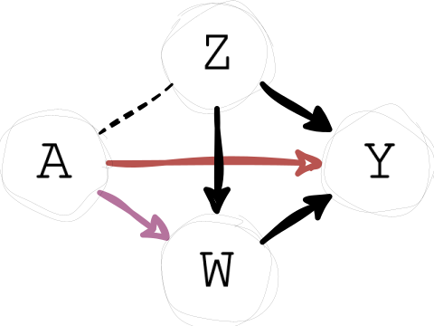
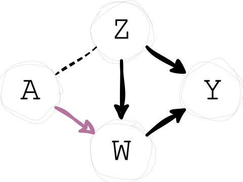

# Ziel und Forschungsfragen {#target}

LLM-gestützte juristische Entscheidungen, die erklären, *ob* sie verzerrt sind und *wie* sich der Bias mindern lässt.

::: {.pipeline .fragment}
::: {.stage}
[<i class="fa-solid fa-file-lines"></i>Gerichtsakte]{.box}
[<i class="fa-solid fa-scale-balanced"></i> FF1 definieren]{.rq}
:::
::: {.stage}
[<i class="fa-solid fa-robot"></i>LLM]{.box}
[<i class="fa-solid fa-shield-halved"></i> FF3 mindern]{.rq}
:::
::: {.stage}
[<i class="fa-solid fa-gavel"></i>Entscheidung]{.box}
[<i class="fa-solid fa-magnifying-glass"></i> FF2 identifizieren]{.rq}
:::
::: {.stage}
[<i class="fa-solid fa-comment-dots"></i>Erklärung]{.box}
[<i class="fa-solid fa-comment-dots"></i> FF4 erklären]{.rq}
:::
:::

::: {.rq-list .fragment .incremental}
- [<i class="fa-solid fa-scale-balanced"></i> FF1]{.rq} Wie lässt sich Bias in juristischen Entscheidungen **definieren**? → [Schritt 1](#step-1)
- [<i class="fa-solid fa-magnifying-glass"></i> FF2]{.rq} Wie lässt sich Bias in LLM-gestützten juristischen Entscheidungen **identifizieren**? → [Schritt 2](#step-2)
- [<i class="fa-solid fa-shield-halved"></i> FF3]{.rq} Wie lässt sich Bias in LLM-gestützten juristischen Entscheidungen **mindern**? → [Schritt 3](#step-3)
- [<i class="fa-solid fa-comment-dots"></i> FF4]{.rq} Wie lässt sich Bias in LLM-gestützten juristischen Entscheidungen **erklären**? → [Schritt 4](#step-4)
:::

# Kausale Bias-Pfade in juristischer Entscheidungsfindung [<i class="fa-solid fa-scale-balanced"></i> FF1a]{.rq} {#pathways}
Über welche kausalen Pfade (Mediatoren, Confounder) beeinflussen sensible Merkmale Entscheidungen?

:::: {.columns .fragment}
::: {.column width="45%"}
{.dag width="80%"}
:::
::: {.column width="55%" .callout-tip icon="false" appearance="simple"}
## Beispiel (illustrativ): Trunkenheitsfahrt

- **A** sensibles Merkmal: Staatsangehörigkeit
- **Z** Confounder: Alter
- **W** Mediator: verkehrsrechtliche Vorstrafen
- **Y** Entscheidung: Geldstrafe und Dauer des Fahrverbots

[Direkt]{.path-direct-bias} A → Y<br/>[Indirekt]{.path-indirect-bias} A → W → Y<br/>Scheinbar A ┄ Z → Y
:::
::::


# Schritt 2: Testen [<i class="fa-solid fa-magnifying-glass"></i> FF2]{.rq} {#step-2}

::: {.callout-note .fragment appearance="simple"}
## Methode
1. **Generierung** gekoppelter **faktischer** und **kontrafaktischer** Test**datensätze** je Bias-Pfad
2. Generierung von **LLM-Entscheidungen** für jeden faktischen und kontrafaktischen Testdatensatz
3. **Vergleich** der LLM-Entscheidungen zur Quantifizierung des Effekts je Bias-Pfad
:::

::: {.fragment}
```{=html}
<div class="testflow">
  <div class="hd">Kausaler DAG</div><div></div><div class="hd">Testfälle</div><div></div><div class="hd">LLM</div><div></div><div class="hd">Entscheidung</div><div></div><div class="hd">Effekt</div>
  <div class="dagcell"><span class="lab">Faktisch</span></div>
  <div class="arr"><i class="fa-solid fa-arrow-right"></i></div>
  <div class="box contrib"><i class="fa-solid fa-file-lines"></i>Akte</div>
  <div class="arr"><i class="fa-solid fa-arrow-right"></i></div>
  <div class="box llm"><i class="fa-solid fa-robot"></i>LLM</div>
  <div class="arr"><i class="fa-solid fa-arrow-right"></i></div>
  <div class="box"><i class="fa-solid fa-gavel"></i><span>Y</span></div>
  <div class="arr"><i class="fa-solid fa-arrow-right"></i></div>
  <div class="box effect contrib"><span class="ttl"><i class="fa-solid fa-magnifying-glass"></i> Vergleich</span>
    <table class="efftab">
      <thead><tr><th>Pfad</th><th>Kontrast</th><th>Δ Mon.*</th><th>p*</th></tr></thead>
      <tbody>
        <tr><td class="path-direct-bias">direkt</td><td>Y − Y′<sub>1</sub></td><td>+1,2</td><td>&lt;,001</td></tr>
        <tr><td class="path-indirect-bias">indirekt</td><td>Y′<sub>1</sub> − Y′<sub>2</sub></td><td>+0,5</td><td>,041</td></tr>
        <tr class="total"><td>gesamt</td><td>Y − Y′<sub>2</sub></td><td>+1,7</td><td>&lt;,001</td></tr>
      </tbody>
    </table>
    <small class="note">* illustrativ</small>
  </div>
  <div class="dagcell"><span class="lab">Kontrafaktisch 1<br/><small>ohne direkten Pfad</small></span></div>
  <div class="arr"><i class="fa-solid fa-arrow-right"></i></div>
  <div class="box contrib"><i class="fa-solid fa-file-lines"></i><span>Akte′<sub>1</sub></span></div>
  <div class="arr"><i class="fa-solid fa-arrow-right"></i></div>
  <div class="arr"><i class="fa-solid fa-arrow-right"></i></div>
  <div class="box"><i class="fa-solid fa-gavel"></i><span>Y′<sub>1</sub></span></div>
  <div class="arr"><i class="fa-solid fa-arrow-right"></i></div>
  <div class="dagcell"><span class="lab">Kontrafaktisch 2<br/><small>ohne Bias-Pfade</small></span></div>
  <div class="arr"><i class="fa-solid fa-arrow-right"></i></div>
  <div class="box contrib"><i class="fa-solid fa-file-lines"></i><span>Akte′<sub>2</sub></span></div>
  <div class="arr"><i class="fa-solid fa-arrow-right"></i></div>
  <div class="arr"><i class="fa-solid fa-arrow-right"></i></div>
  <div class="box"><i class="fa-solid fa-gavel"></i><span>Y′<sub>2</sub></span></div>
  <div class="arr"><i class="fa-solid fa-arrow-right"></i></div>
</div>
```
:::

::: {.callout-tip .fragment appearance="simple"}
## Beitrag
- **Generierungspipeline** für gekoppelte faktisch-kontrafaktische Testdatensätze
- **Quantifizierung** kausaler Bias-Effekte in LLM-gestützten Entscheidungen
:::


# Schritt 3: Minderung [<i class="fa-solid fa-shield-halved"></i> FF3]{.rq} {#step-3}

::: {.callout-note .fragment appearance="simple"}
## Methode
1. **Vorverarbeitung** der Eingabedaten mit einem Text-Autoencoder und **MLOs**.
2. Generierung von Entscheidungen für alle faktischen und kontrafaktischen Versionen des DAG.
:::

::: {.fragment}
```{=html}
<div class="testflow mitflow">
  <div class="hd">Original</div><div></div><div class="hd">Kodieren</div><div></div><div class="hd">MLO-Intervention</div><div></div><div class="hd">Dekodieren</div><div></div><div class="hd">Veränderte Akten</div><div></div><div class="hd">LLM</div><div></div><div class="hd">Entscheidungs&shy;optionen</div>
  <div class="box tall" style="grid-row:2 / span 3; grid-column:1"><i class="fa-solid fa-file-lines"></i><span>Akte</span></div>
  <div class="link" style="grid-row:2; grid-column:2 / 11"><i class="fa-solid fa-arrow-right"></i></div>
  <div class="dagcell marker" style="grid-row:2; grid-column:5"></div>
  <div class="arr tall" style="grid-row:3 / span 2; grid-column:2"><i class="fa-solid fa-arrow-right"></i></div>
  <div class="box tall" style="grid-row:3 / span 2; grid-column:3"><i class="fa-solid fa-compress"></i><span>Encoder</span></div>
  <div class="box tall" style="grid-row:3 / span 2; grid-column:7"><i class="fa-solid fa-expand"></i><span>Decoder</span></div>
  <div class="box tall" style="grid-row:2 / span 3; grid-column:11"><i class="fa-solid fa-robot"></i><span>LLM</span></div>
  <div class="arr" style="grid-row:2; grid-column:12"><i class="fa-solid fa-arrow-right"></i></div>
  <div class="box dec" style="grid-row:2; grid-column:13"><i class="fa-solid fa-gavel"></i><span>Y</span><span class="lab">faktisch</span></div>
  <div class="arr" style="grid-row:3; grid-column:4"><i class="fa-solid fa-arrow-right"></i></div>
  <div class="dagcell" style="grid-row:3; grid-column:5"><div class="box contrib"><i class="fa-solid fa-shield-halved"></i><span>MLO</span></div></div>
  <div class="arr" style="grid-row:3; grid-column:6"><i class="fa-solid fa-arrow-right"></i></div>
  <div class="arr" style="grid-row:3; grid-column:8"><i class="fa-solid fa-arrow-right"></i></div>
  <div class="box" style="grid-row:3; grid-column:9"><i class="fa-solid fa-file-lines"></i><span>Akte′<sub>1</sub></span></div>
  <div class="arr" style="grid-row:3; grid-column:10"><i class="fa-solid fa-arrow-right"></i></div>
  <div class="arr" style="grid-row:3; grid-column:12"><i class="fa-solid fa-arrow-right"></i></div>
  <div class="box dec" style="grid-row:3; grid-column:13"><i class="fa-solid fa-gavel"></i><span>Y′<sub>1</sub></span><span class="lab">ohne direkten<br/>Bias</span></div>
  <div class="arr" style="grid-row:4; grid-column:4"><i class="fa-solid fa-arrow-right"></i></div>
  <div class="dagcell" style="grid-row:4; grid-column:5"><div class="box contrib"><i class="fa-solid fa-shield-halved"></i><span>MLO</span></div></div>
  <div class="arr" style="grid-row:4; grid-column:6"><i class="fa-solid fa-arrow-right"></i></div>
  <div class="arr" style="grid-row:4; grid-column:8"><i class="fa-solid fa-arrow-right"></i></div>
  <div class="box" style="grid-row:4; grid-column:9"><i class="fa-solid fa-file-lines"></i><span>Akte′<sub>2</sub></span></div>
  <div class="arr" style="grid-row:4; grid-column:10"><i class="fa-solid fa-arrow-right"></i></div>
  <div class="arr" style="grid-row:4; grid-column:12"><i class="fa-solid fa-arrow-right"></i></div>
  <div class="box dec" style="grid-row:4; grid-column:13"><i class="fa-solid fa-gavel"></i><span>Y′<sub>2</sub></span><span class="lab">bias-frei</span></div>
</div>
```
:::

::: {.callout-tip .fragment appearance="simple"}
## Beitrag
Anwendung von MLOs [@kestel2026mlo]
:::


# Schritt 4: Erklärung [<i class="fa-solid fa-comment-dots"></i> FF4]{.rq} {#step-4}

::: {.callout-note .fragment appearance="simple"}
## Methode
Ein LLM erklärt das Ergebnis der Effektquantifizierung aus Schritt 3 in natürlicher Sprache.
:::

::: {.fragment}
```{=html}
<div class="testflow expflow">
  <div class="hd">Entscheidungsoptionen</div><div></div><div class="hd">Effekte im Einzelfall</div><div></div><div class="hd">Erklärer</div><div></div><div class="hd">Erklärung</div>
  <div class="dagcell" style="grid-row:2; grid-column:1"><div class="box"><i class="fa-solid fa-gavel"></i><span>Y = 9,0</span></div></div>
  <div class="arr" style="grid-row:2; grid-column:2"><i class="fa-solid fa-arrow-right"></i></div>
  <div class="dagcell" style="grid-row:3; grid-column:1"><div class="box"><i class="fa-solid fa-gavel"></i><span>Y′<sub>1</sub> = 7,8</span></div></div>
  <div class="arr" style="grid-row:3; grid-column:2"><i class="fa-solid fa-arrow-right"></i></div>
  <div class="dagcell" style="grid-row:4; grid-column:1"><div class="box"><i class="fa-solid fa-gavel"></i><span>Y′<sub>2</sub> = 7,3</span></div></div>
  <div class="arr" style="grid-row:4; grid-column:2"><i class="fa-solid fa-arrow-right"></i></div>
  <div class="box tall effect" style="grid-row:2 / span 3; grid-column:3"><span class="ttl"><i class="fa-solid fa-magnifying-glass"></i> Effekte</span>
    <table class="efftab">
      <thead><tr><th>Pfad</th><th>Kontrast</th><th>Δ Mon.*</th></tr></thead>
      <tbody>
        <tr><td class="path-direct-bias">direkt</td><td>Y − Y′<sub>1</sub></td><td>+1,2</td></tr>
        <tr><td class="path-indirect-bias">indirekt</td><td>Y′<sub>1</sub> − Y′<sub>2</sub></td><td>+0,5</td></tr>
        <tr class="total"><td>gesamt</td><td>Y − Y′<sub>2</sub></td><td>+1,7</td></tr>
      </tbody>
    </table>
    <small class="note">* illustrativ, ein Fall</small>
  </div>
  <div class="arr tall" style="grid-row:2 / span 3; grid-column:4"><i class="fa-solid fa-arrow-right"></i></div>
  <div class="box tall" style="grid-row:2 / span 3; grid-column:5"><i class="fa-solid fa-robot"></i><span>Erklärer</span></div>
  <div class="arr tall" style="grid-row:2 / span 3; grid-column:6"><i class="fa-solid fa-arrow-right"></i></div>
  <div class="bubble tall" style="grid-row:2 / span 3; grid-column:7"><i class="fa-solid fa-comment-dots"></i>
    <p>„Das vorgeschlagene Fahrverbot beträgt <b>9,0 Monate</b>. Für eine ansonsten identische Person mit deutscher Staatsangehörigkeit wäre es <b>1,7 Monate kürzer</b>: <span class="path-direct-bias">1,2 Monate</span> gehen direkt auf die Staatsangehörigkeit zurück, <span class="path-indirect-bias">0,5 Monate</span> auf die damit verbundenen Vorstrafen.“</p>
  </div>
</div>
```
:::

::: {.callout-tip .fragment appearance="simple"}
## Beitrag
- Anwendung der LLM-Erklärungsmethodik [@berarducci2026cfa_llm]
- Verständliche Erklärung kausaler Bias-Effekte in einer konkreten LLM-gestützten Entscheidung
:::

# Schritt 1: Konzeptualisierung [<i class="fa-solid fa-scale-balanced"></i> FF1b]{.rq} {#step-1}

::: {.callout-note .fragment appearance="simple"}
## Methode
- Workshops mit Rechtsexpert:innen zur Identifikation kausaler Pfade und Konstruktion kausaler DAGs
- Zusammenarbeit mit dem ADA-Projekt^[[ada-oeffentliche-verwaltung.de](https://ada-oeffentliche-verwaltung.de)]
- 1 Workshop pro Anwendungsfall
:::

::: {.fragment}
```{=html}
<div class="testflow defflow">
  <div class="hd">Anwendungsfall</div><div></div><div class="hd">Erhebung</div><div></div><div class="hd">Kausaler DAG</div><div></div><div class="hd">Bias-Pfade</div><div></div><div class="hd">Kontrafaktische DAGs</div>
  <div class="box tall" style="grid-row:2 / span 2; grid-column:1"><i class="fa-solid fa-folder-open"></i><span>Trunken&shy;heits&shy;fahrt</span></div>
  <div class="arr tall" style="grid-row:2 / span 2; grid-column:2"><i class="fa-solid fa-arrow-right"></i></div>
  <div class="box tall contrib" style="grid-row:2 / span 2; grid-column:3"><i class="fa-solid fa-users"></i><span>Expert:innen-<br/>workshop</span><span class="lab">Rechtsexpert:innen<br/>+ ADA</span></div>
  <div class="arr tall" style="grid-row:2 / span 2; grid-column:4"><i class="fa-solid fa-arrow-right"></i></div>
  <div class="bigdag tall contrib" style="grid-row:2 / span 2; grid-column:5"></div>
  <div class="arr" style="grid-row:2; grid-column:6"><i class="fa-solid fa-arrow-right"></i></div>
  <div class="box path" style="grid-row:2; grid-column:7"><span class="path-direct-bias">direkt</span><span>A → Y</span></div>
  <div class="arr" style="grid-row:2; grid-column:8"><i class="fa-solid fa-arrow-right"></i></div>
  <div class="dagcell" style="grid-row:2; grid-column:9"><span class="lab">ohne direkten Pfad</span></div>
  <div class="arr" style="grid-row:3; grid-column:6"><i class="fa-solid fa-arrow-right"></i></div>
  <div class="box path" style="grid-row:3; grid-column:7"><span class="path-indirect-bias">indirekt</span><span>A → W → Y</span></div>
  <div class="arr" style="grid-row:3; grid-column:8"><i class="fa-solid fa-arrow-right"></i></div>
  <div class="dagcell" style="grid-row:3; grid-column:9"><span class="lab">ohne Bias-Pfade</span></div>
</div>
```
:::

::: {.callout-tip .fragment appearance="simple"}
## Beitrag
- **Workshop-/Interview-Leitfaden** zur Erhebung kausaler DAGs
- Kausaler **DAG** für jeden Anwendungsfall [@plecko2022sfm]
:::

# Finales Modul zur Bias-Quantifizierung und -Minderung

```{=html}
<div class="testflow modflow">
  <div class="lane" style="grid-row:1; grid-column:1 / 4">Schritt 1: Konzeptualisierung</div>
  <div class="lane" style="grid-row:1; grid-column:5 / 7">Schritt 2: Testen</div>
  <div class="lane" style="grid-row:1; grid-column:7 / 12">Schritte 2–3: LLM-gestützte Entscheidungen</div>
  <div class="lane" style="grid-row:1; grid-column:12 / -1">Schritt 4: Erklärung</div>
  <div class="box contrib" style="grid-row:2; grid-column:1"><i class="fa-solid fa-users"></i><span>Workshop</span></div>
  <div class="arr" style="grid-row:2; grid-column:2"><i class="fa-solid fa-arrow-right"></i></div>
  <div class="bigdag contrib" style="grid-row:2; grid-column:3"></div>
  <div class="arr" style="grid-row:2; grid-column:4"><i class="fa-solid fa-arrow-right"></i></div>
  <div class="box contrib" style="grid-row:2; grid-column:5"><i class="fa-solid fa-file-lines"></i><span>Testfälle</span></div>
  <div class="arr" style="grid-row:2; grid-column:6"><i class="fa-solid fa-arrow-right"></i></div>
  <div class="lane" style="grid-row:3; grid-column:1 / 7"></div>
  <div class="lane bare" style="grid-row:3; grid-column:4 / 7">Schritt 3: Minderung</div>
  <div class="varr" style="grid-row:3; grid-column:3"><i class="fa-solid fa-arrow-down"></i></div>
  <div class="box tall" style="grid-row:4 / span 2; grid-column:1"><i class="fa-solid fa-file-lines"></i><span>Akte</span></div>
  <div class="arr" style="grid-row:4; grid-column:2"><i class="fa-solid fa-arrow-right"></i></div>
  <div class="box contrib" style="grid-row:4; grid-column:3"><i class="fa-solid fa-shield-halved"></i><span>MLO</span></div>
  <div class="arr" style="grid-row:4; grid-column:4"><i class="fa-solid fa-arrow-right"></i></div>
  <div class="box" style="grid-row:4; grid-column:5"><i class="fa-solid fa-file-lines"></i><span>Akte′</span></div>
  <div class="arr" style="grid-row:4; grid-column:6"><i class="fa-solid fa-arrow-right"></i></div>
  <div class="link" style="grid-row:5; grid-column:2 / 7"><i class="fa-solid fa-arrow-right"></i></div>
  <div class="box tall" style="grid-row:2 / span 4; grid-column:7"><i class="fa-solid fa-robot"></i><span>LLM</span></div>
  <div class="arr tall" style="grid-row:2 / span 4; grid-column:8"><i class="fa-solid fa-arrow-right"></i></div>
  <div class="box tall short" style="grid-row:2 / span 4; grid-column:9"><i class="fa-solid fa-gavel"></i><span>Y, Y′</span><span class="lab">faktisch &amp;<br/>kontrafaktisch</span></div>
  <div class="arr tall" style="grid-row:2 / span 4; grid-column:10"><i class="fa-solid fa-arrow-right"></i></div>
  <div class="box tall short contrib" style="grid-row:2 / span 4; grid-column:11"><i class="fa-solid fa-magnifying-glass"></i><span>Effekte</span><span class="lab">je Bias-Pfad</span></div>
  <div class="arr tall" style="grid-row:2 / span 4; grid-column:12"><i class="fa-solid fa-arrow-right"></i></div>
  <div class="box tall short contrib" style="grid-row:2 / span 4; grid-column:13"><i class="fa-solid fa-comment-dots"></i><span>Erklärung</span><span class="lab">Bias-Effekte dieser<br/>Entscheidung</span></div>
</div>
```

# Literatur
